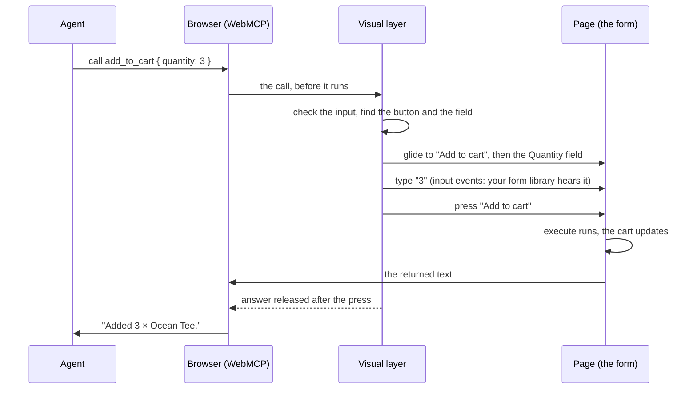

An agent-ready page has three layers, and each one knows as little as possible about the others.

| Layer | What it is | Knows about |
|---|---|---|
| **Tools** | A tool in a component (`useWebTool`) or in your app's catalog (`<WebAgentsProvider tools>`) | the page's own state, nothing else |
| **WebMCP** | `document.modelContext`: native in Chrome, or the [polyfill](/more/polyfill) | the registered tools; dispatches lifecycle events |
| **The visual layer** | `installAgentVisuals()`: the cursor, the spotlight, yielding | WebMCP events and the DOM, never a tool's code |

You never wire them together. The provider (or [`createWebAgents`](/installation/no-framework)) installs the visual layer
before the first tool registers, and that is the whole connection.

## Tools never know the cursor exists

A tool does not call the cursor, import it or report to it. It is `execute`, plus an optional `target`. Nothing is added
to your markup: **the library finds the control the way a person would, by its role and its name.** When an agent calls
`clear_cart`, the visual layer looks for a button named like the tool's `title` ("Clear cart"); a `target` says which
control when the name is not enough ([How the cursor finds the control](/build/define-a-tool#how-the-cursor-finds-the-control)).

That keeps tools plain and testable, lets you add or remove the cursor without touching them, and means tools from other
libraries (anything that calls `registerTool`) animate too, when a control on the page is named like them.

Chat **Restore** (rewind the conversation to before a user message) is separate from typing: the chat truncates the
thread, puts prior field values back from an in-memory journal, and calls an optional tool `revert` for cart, navigation
and other side effects. A tool that only types needs no `revert`; one that mutates the page should define it
([`defineWebTool`](/reference/core/define-web-tool), [`session.restore`](/reference/chat/use-agent-session#restore)).

The one thing the cursor reads from a tool is a small description of the call, which `defineWebTool` keeps beside the
tool: which control it acts on, and which field each parameter is typed into. Core builds it from the tool's `title`,
`target`, `fields` and input schema before anything moves, so a bad input answers at once and never moves the cursor.

## One call, start to finish

`installAgentVisuals()` subscribes to the WebMCP lifecycle and works everything else out from the DOM at that moment.

| Signal | What the layer does |
|---|---|
| A tool call arrives | validates the input, finds the control and each parameter's field, then glides there |
| `toolcancel` | clears highlights and hides the cursor |
| The person's own mouse, scroll, touch or keys | they took over: [the cursor yields](/concepts/agent-cursor#yielding-to-the-person) |
| `toolactivated`, `input`, `submit` with `agentInvoked` | the same run for a [declarative form](/more/declarative-forms), whose fields the browser fills itself |

Native Chrome and the polyfill fire the lifecycle events in different orders (Chrome fills, submits, then activates; the
polyfill activates first), so a run starts on whichever signal arrives first.

## The page reacts at the click

<video autoPlay loop muted playsInline data-no-zoom width="960">
  <source src="../media/cursor/typing.webm" type="video/webm" />
  <source src="../media/cursor/typing.mp4" type="video/mp4" />
</video>

*The cart updates when the cursor clicks, not before.*

The browser runs an agent's action the instant it is called. A cursor that animated afterwards would always look late:
the cart would update, and only then would the cursor drift over to "Add to cart". So by default (`sync: true`) the
layer makes the page wait for the cursor instead.

| Tool kind | Without the layer | With it |
|---|---|---|
| A tool with a control on the page | `execute()` runs at once, fields never move | the cursor goes to the control, types each value into its field, runs `fill`, presses the control; `execute()` runs at the press |
| A tool that needs confirmation | `execute()` waits for a click | the same, but the cursor parks on the control and `execute()` runs on the person's click |
| A tool with nothing on screen | `execute()` runs | still runs at once: there is nothing to show |

Your tool code does not change; it just runs at the click, so the page reacts in the same frame as the ripple. The agent
gets its answer roughly half a second to a second later than it would without the cursor. A held call is never held for
more than 2.5 s plus 2.5 s per field it types, and cancelling releases it: at that point the tool writes the values the
cursor had not and runs. `sync: false` runs everything at once and animates after the fact.

:::tip[For every tool to be in sync]
Install the visual layer before any tool registers (the provider and `createWebAgents` do), and give each tool a control
the cursor can find: a `title` that names its button, or a `target`.
:::

## Limits

- **What the cursor cannot type into, it only visits.** A custom select or a date picker has no text to type; show its
  value with [`fill`](/build/tools-with-input#how-the-cursor-fills-a-form).
- **`toolactivated` carries only the tool's name**, not its arguments. For a declarative form the layer therefore
  watches `input` events: the fields that change as a run starts are the agent's, and their previous values come from a
  snapshot it refreshes every 400 ms while nothing runs.
- **A declarative fill Chrome rejects never submits** (a quantity above the field's `max`). The layer closes that run
  after `linger`, so the next call starts fresh.
- **One patch.** In sync mode the layer wraps `registerTool`; following the URL patches `history.pushState` and
  `replaceState` only where the browser has no Navigation API, and only while something watches.

## Events for everything else

Every run emits events you can subscribe to, with no access to internals: `start`, `fill`, `park`, `result`, `error`,
`cancel`, `yield` and `resume`. The [devtools](/build/devtools) timeline and the chat are built on exactly these events.
In code, [`onAgentEvent`](/reference/core/on-agent-event); in React, [`useAgentEvents`](/reference/react/use-agent-events).

## Where to go next

<CardGroup cols={3}>
  <Card title="The agent cursor" href="/concepts/agent-cursor" icon="mouse-pointer">
    How it moves, parks for a confirmation and gets out of the person's way.
  </Card>
  <Card title="Tool lifecycle" href="/concepts/tool-lifecycle" icon="refresh-cw">
    Why a tool is never unregistered in the middle of a call.
  </Card>
  <Card title="Define a tool" href="/build/define-a-tool" arrow>
    Start building: one function, two callers.
  </Card>
</CardGroup>
