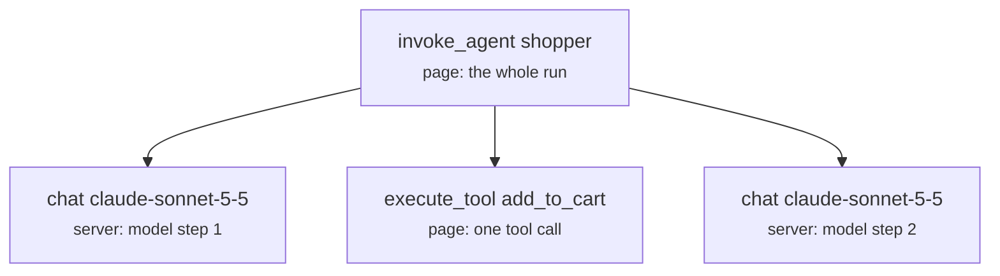

When an agent misbehaves in production, you want to see what it did: which tools it called, how long the person took
to confirm, which model step was slow, how many tokens it spent. `@webmcp-agents/telemetry` records that as
OpenTelemetry spans and sends them to any backend that speaks OpenTelemetry.

:::note[Experimental]
`@webmcp-agents/telemetry` and the run events it is built on are new in 0.5.0, and the OpenTelemetry GenAI conventions
they follow are not stable yet. Span and attribute names may change in a minor release.
:::

## What one turn looks like

One message from the person is one trace. The page records the run and its tool calls; the server records each model
step. The two sides share the trace through the `traceparent` header the chat sends with every step, so a backend
shows them as one tree:

<CardGroup cols={2}>
  <Card title="invoke_agent" icon="bot">
    The run, from the page: the agent, how it ended, how many steps, the page's URL (redacted).
  </Card>
  <Card title="chat" icon="message-square">
    One model step, from the server: the model, input and output tokens, the step number.
  </Card>
  <Card title="execute_tool" icon="wrench">
    One tool call, from the page: its outcome, the wait for the person, whether they confirmed.
  </Card>
  <Card title="invoke_agent (sub-agent)" icon="git-fork">
    A sub-agent's run, under the tool call that delegated to it.
  </Card>
</CardGroup>

Every span carries `webmcp.conversation.id` and `webmcp.run.id`. Prompts, outputs and tool data are not recorded
unless you turn them on ([Privacy and redaction](/observability/privacy)). The names and attributes are on
[Span names and types](/observability/spans).

## How it works

<Steps>
  <Step title="The server layer">
    `defineObservability()` goes on the chat handler. Every model step becomes a `chat` span, sent where the standard
    `OTEL_*` variables (or a provider your app already registered) say.
  </Step>
  <Step title="The relay">
    The page posts its spans to your own `/api/telemetry`, which checks and redacts them again and forwards them
    through the same layer. The backend's key never reaches the browser.
  </Step>
  <Step title="The page's observer">
    One component next to the chat turns each run and tool call into spans. Nothing loads until a run starts.
  </Step>
</Steps>

## Choose your backend

Pick one. Its installation page is the six steps for that backend, and every telemetry page after it shows what
differs for it.

<include>/_partials/backends.mdx</include>

## Already set up?

| I want to… | Read |
|---|---|
| See every API on one page | [The telemetry APIs](/observability/apis) |
| Send to a second backend | [Collector and troubleshooting](/observability/collector) |
| Keep a share of turns | [Sampling](/observability/sampling) |
| Group a conversation in my backend | [metadataMapping](/observability/metadata-mapping) |
| Record prompts, or ask for consent | [Privacy and redaction](/observability/privacy) |
| Count runs without a backend | [onAgentRun](/observability/on-agent-run) |
| Test the span tree | [Test privacy and telemetry](/testing/privacy-and-telemetry) |
