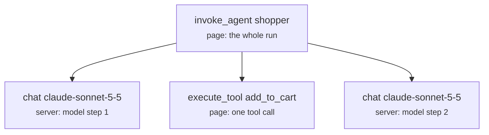

When an agent misbehaves in production, you want to see what it did: which tools it called, how long the person took
to confirm, which model step was slow, how many tokens it spent. `@webmcp-agents/telemetry` records that as
OpenTelemetry spans and sends them to the backend you already use, or to any of the [backends](/observability/backends)
that speak OpenTelemetry.

Experimental: `@webmcp-agents/telemetry` and the run events it is built on are new in 0.5.0, and the OpenTelemetry
GenAI conventions they follow are not stable yet. Span and attribute names may change in a minor release.

## What one turn looks like

One message from the person is one trace. The page records the run and its tool calls; the server records each model
step. The two sides share the trace through the `traceparent` header the chat sends with every step, so a backend
shows them as one tree:



| Span | Where | What it carries |
|---|---|---|
| `invoke_agent <agent>` | page | The run: the agent, the adapter, how it ended (`stop`, `max-steps`, `aborted`, `error`), how many steps, the page's URL (redacted). |
| `chat <model>` | server | One model step: the model, input and output tokens, the step number. |
| `execute_tool <tool>` | page | One tool call: its outcome and error code, the time spent waiting for the person, whether they confirmed. Events for parking and for the cursor yielding. |
| `invoke_agent <sub-agent>` | page | A sub-agent's run, under the tool call that delegated to it. |

Every span carries `webmcp.conversation.id` and `webmcp.run.id`, so you can find every turn of one conversation.
Prompts, outputs and tool data are not recorded unless you turn them on ([Privacy and consent](/observability/privacy)).
The names and attributes are listed on [the span reference](/reference/telemetry/semconv).

## A complete example

Four pieces: the layer, the chat route that uses it, a route for the page's spans, and one component on the page.

```package-install
npm i @webmcp-agents/telemetry @opentelemetry/api @opentelemetry/sdk-trace @ai-sdk/otel
```

The three OpenTelemetry packages are loaded on the server's first request; the page needs none of them.

<View title="Vite">

<include meta='title="src/lib/observability.ts"'>/_examples/shared/lib/observability.ts</include>

<include meta='title="api/chat.ts" {3,6}'>/_examples/vite/api/chat.observed.ts</include>

<include meta='title="api/telemetry.ts"'>/_examples/vite/api/telemetry.ts</include>

<include meta='title="src/components/observe-runs.tsx"'>/_examples/shared/components/observe-runs.tsx</include>

</View>

<View title="Next.js">

<include meta='title="lib/observability.ts"'>/_examples/shared/lib/observability.ts</include>

<include meta='title="app/api/chat/route.ts" {4,6}'>/_examples/nextjs/app/api/chat/route.observed.ts</include>

<include meta='title="app/api/telemetry/route.ts"'>/_examples/nextjs/app/api/telemetry/route.ts</include>

<include meta='title="components/observe-runs.tsx"'>/_examples/nextjs/components/observe-runs.tsx</include>

</View>

<View title="TanStack Start">

<include meta='title="src/lib/observability.ts"'>/_examples/shared/lib/observability.ts</include>

<include meta='title="src/routes/api/chat.ts" {5,7}'>/_examples/tanstack-start/src/routes/api/chat.observed.ts</include>

<include meta='title="src/routes/api/telemetry.ts"'>/_examples/tanstack-start/src/routes/api/telemetry.ts</include>

<include meta='title="src/components/observe-runs.tsx"'>/_examples/shared/components/observe-runs.tsx</include>

</View>

<View title="Astro">

<include meta='title="src/lib/observability.ts"'>/_examples/astro/src/lib/observability.ts</include>

<include meta='title="src/pages/api/chat.ts" {6,12}'>/_examples/astro/src/pages/api/chat.observed.ts</include>

<include meta='title="src/pages/api/telemetry.ts"'>/_examples/astro/src/pages/api/telemetry.ts</include>

<include meta='title="src/components/observe-runs.tsx"'>/_examples/shared/components/observe-runs.tsx</include>

</View>

Render `<ObserveRuns />` once, inside `<WebAgentsProvider>`, next to the chat. Without React, call
[`observeAgents()`](/observability/browser-spans#without-react) once instead.

## Point it at a backend

Nothing above names a backend. Where spans go is the standard OpenTelemetry environment, so switching backend is a
change of two variables, not of code. To try it on your machine, run an OpenTelemetry Collector that prints what it
receives (the [Collector page](/observability/collector) has the file and the command), then:

<include meta='title=".env.local"'>/_examples/observability/env/local-collector.env</include>

Send one message in the chat, and the Collector prints one trace: the run, its tool calls and its model steps. For a
hosted backend, take its block from [Backends](/observability/backends). With no variable set and nothing else
configured, the layer is off and costs nothing.

## Without a backend

To count runs, failed tools or tokens in your own analytics, you need no telemetry package at all: subscribe to the
run events with [`onAgentRun`](/observability/on-agent-run).

## Test it

[Test privacy and telemetry](/testing/privacy-and-telemetry) checks the span tree and that no secret reaches a span.
