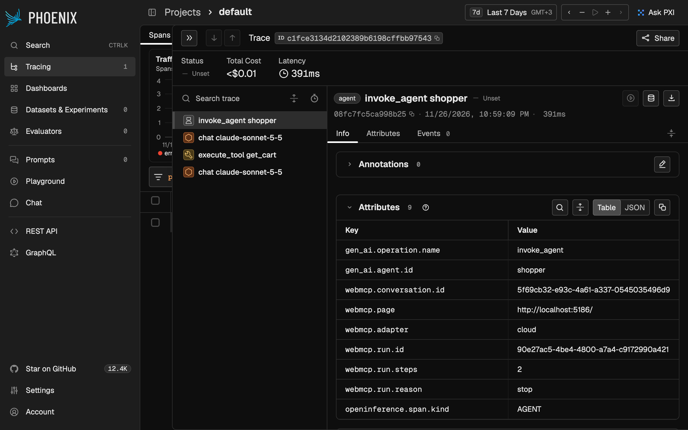

<RememberBackend name="Arize" />

:::note[Not run by us]
Written from Arize's docs, the `@arizeai/openinference-vercel` package (3.3.6) and Phoenix's source on 2026-11-25.
:::

Six steps, from the packages to one trace per turn in Arize: the same six on every backend's page. The framework
picker above the code picks your routes; the backend stays picked for the pages after this one.

<div class="install-steps">

## Install the packages

The telemetry layer and its OpenTelemetry packages, plus OpenInference's converter and the protobuf exporter: Arize reads OpenInference attributes, and `@arizeai/openinference-vercel` converts the AI SDK's spans to them (version 3 is for `ai@7`, whose `gen_ai.*` spans this library emits by default).

```package-install
npm install @webmcp-agents/telemetry @opentelemetry/api @opentelemetry/sdk-trace @ai-sdk/otel @arizeai/openinference-vercel @opentelemetry/exporter-trace-otlp-proto
```

## Set the environment

The example reads `ARIZE_SPACE_ID` and `ARIZE_API_KEY`. Arize AX and Phoenix differ in where and how:

<Columns cols={2}>
  <Column>
    <Card title="Arize AX" icon="cloud">

    - `https://otlp.arize.com/v1/traces` (EU: `https://otlp.eu-west-1a.arize.com/v1/traces`)
    - `arize-space-id` and `arize-api-key` headers
    - Protobuf in every example; JSON not stated

    </Card>
  </Column>
  <Column>
    <Card title="Phoenix" icon="server">

    - `http://<host>:6006/v1/traces` (the UI's port); Phoenix Cloud: the hostname in Settings
    - `Authorization: Bearer <PHOENIX_API_KEY>`
    - Protobuf only: anything else gets `415`

    </Card>
  </Column>
</Columns>

Both file traces under the resource attribute `openinference.project.name`, which the layer sets in step 3.

## Add the server layer

OpenInference's span processor around a protobuf exporter, the project, and the key Arize groups a session by:

<include meta='title="lib/observability.ts"'>/_examples/observability/backends/arize.ts</include>

In Astro, `process.env` does not hold `.env.local` in development: read the variables with `getSecret` from `astro:env/server` and pass them as `env`, as the Astro view of the [generic layer](/observability/installation/otlp#add-the-server-layer) does. The chat route passes the layer to the handler:

<View title="Vite">

<include meta='title="api/chat.ts" {3,6}'>/_examples/vite/api/chat.observed.ts</include>

</View>

<View title="Next.js">

<include meta='title="app/api/chat/route.ts" {4,6}'>/_examples/nextjs/app/api/chat/route.observed.ts</include>

</View>

<View title="TanStack Start">

<include meta='title="src/routes/api/chat.ts" {5,7}'>/_examples/tanstack-start/src/routes/api/chat.observed.ts</include>

</View>

<View title="Astro">

<include meta='title="src/pages/api/chat.ts" {6,12}'>/_examples/astro/src/pages/api/chat.observed.ts</include>

</View>

## Add the relay route

The page's spans come to your own endpoint, so the backend's key never reaches the browser. The relay refuses other origins and requests with no `Origin` (a script, not a page); the `guard` is the per-IP limit for the rest. Keep its counts in a shared store in production, as for the chat ([Limits and budgets](/security/limits)).

<View title="Vite">

<include meta='title="api/telemetry.ts"'>/_examples/vite/api/telemetry.ts</include>

</View>

<View title="Next.js">

<include meta='title="app/api/telemetry/route.ts"'>/_examples/nextjs/app/api/telemetry/route.ts</include>

</View>

<View title="TanStack Start">

<include meta='title="src/routes/api/telemetry.ts"'>/_examples/tanstack-start/src/routes/api/telemetry.ts</include>

</View>

<View title="Astro">

<include meta='title="src/pages/api/telemetry.ts"'>/_examples/astro/src/pages/api/telemetry.ts</include>

</View>

## Observe the page

One component turns each run and tool call on the page into spans and posts them to the relay. Render it once, inside `<WebAgentsProvider>`, next to the chat. Without React, call [`observeAgents()`](/observability/observe-agents) once instead.

<View title="Vite">

<include meta='title="src/components/observe-runs.tsx"'>/_examples/shared/components/observe-runs.tsx</include>

</View>

<View title="Next.js">

<include meta='title="components/observe-runs.tsx"'>/_examples/nextjs/components/observe-runs.tsx</include>

</View>

<View title="TanStack Start">

<include meta='title="src/components/observe-runs.tsx"'>/_examples/shared/components/observe-runs.tsx</include>

</View>

<View title="Astro">

<include meta='title="src/components/observe-runs.tsx"'>/_examples/shared/components/observe-runs.tsx</include>

</View>

## Check it in Arize

Start the app and send one message in the chat. The trace appears under the project the layer names (`field-store`). Arize AX and Phoenix both group sessions by `session.id`, which the layer maps from the conversation id.



*A real trace from Field Store on Next.js in a local Phoenix, captured with `pnpm capture:backend phoenix`. It reached Phoenix
through a Collector, as plain OTLP, not through the OpenInference processor of step 3; the model was a scripted
stand-in.*

</div>

<Expandable title="Sources, and what was not confirmed">

- [Configure your tracer (AX)](https://arize.com/docs/ax/instrument/configure-your-tracer.md): endpoint, headers, project
- [Vercel AI SDK tracing (AX)](https://arize.com/docs/ax/integrations/ts-js-agent-frameworks/vercel/vercel-ai-sdk-tracing.md)
- [Vercel AI SDK tracing (Phoenix)](https://www.arize.com/docs/phoenix/integrations/typescript/vercel/vercel-ai-sdk-tracing-js.md)
- [Phoenix sessions](https://arize.com/docs/phoenix/tracing/how-to-tracing/setup-tracing/setup-sessions): `session.id`
- [Phoenix's OTLP route](https://github.com/Arize-ai/phoenix/blob/main/src/phoenix/server/api/routers/v1/traces.py): protobuf only

Not confirmed: OTLP JSON on AX.

</Expandable>

## Next

<Card title="The telemetry APIs" href="/observability/apis?backend=arize" arrow>
  What you just set up, one API per page: the layer, where spans go, the relay, the page's observer, sampling and
  the conversation key, each showing what differs for Arize.
</Card>
