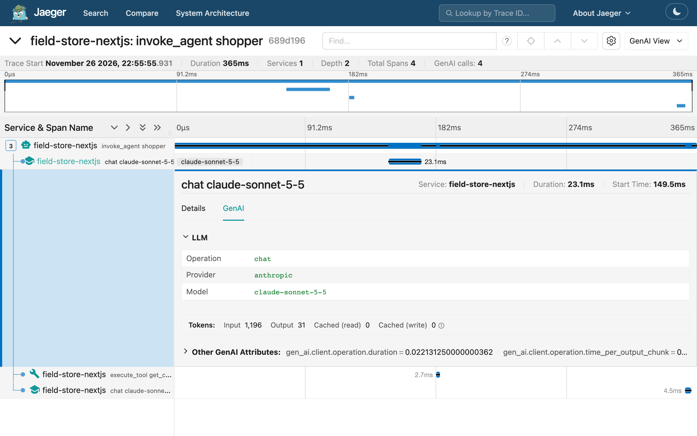
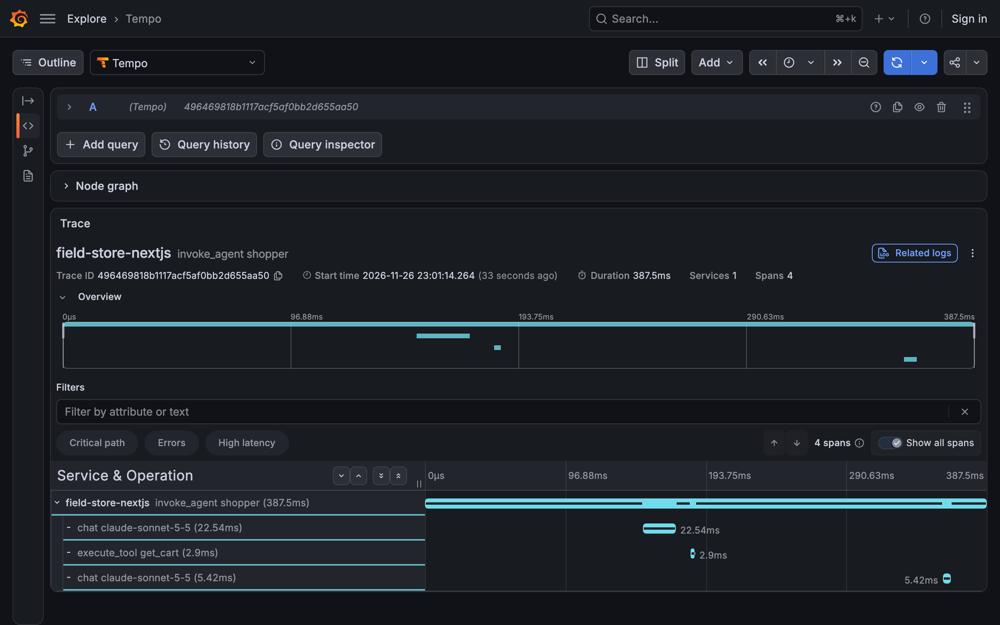

<RememberBackend name="Any OTLP backend" />

:::tip[Verified]
Run against a local OpenTelemetry Collector 0.166.0 over `http/json`, `http/protobuf` and `grpc`: one trace per turn, the page's spans and the server's joined. The hosted backends below were not run by us; their values are from their docs on 2026-11-25.
:::

Six steps, from the packages to one trace per turn in Any OTLP backend: the same six on every backend's page. The framework
picker above the code picks your routes; the backend stays picked for the pages after this one.

<div class="install-steps">

## Install the packages

The telemetry layer, and the three OpenTelemetry packages it loads on the server's first request; the page needs none of them. For a backend that wants protobuf (Grafana beyond testing, SigNoz), add `@opentelemetry/exporter-trace-otlp-proto` and set `OTEL_EXPORTER_OTLP_PROTOCOL=http/protobuf`.

```package-install
npm install @webmcp-agents/telemetry @opentelemetry/api @opentelemetry/sdk-trace @ai-sdk/otel
```

## Set the environment

Where spans go is the standard OpenTelemetry environment: the backend's URL and its auth header. To try it on your machine first, run a Collector that prints what it receives ([the Collector page](/observability/collector#try-it-on-your-machine) has the file and the command):

<include lang="bash" meta='title=".env.local"'>/_examples/observability/env/local-collector.env</include>

For a hosted backend, its URL and header instead. Honeycomb, for example:

<include lang="bash" meta='title=".env"'>/_examples/observability/env/honeycomb.env</include>

Header values are percent-encoded: a space is `%20` (`authorization=Bearer%20<key>`).

<Accordion>
  <AccordionItem title="Grafana Cloud">

  - Endpoint: `https://otlp-gateway-<zone>.grafana.net/otlp`
  - Auth: Basic auth, as the OTLP tile of your stack shows it
  - JSON: accepted; Grafana recommends protobuf beyond testing

  </AccordionItem>
  <AccordionItem title="Honeycomb">

  - Endpoint: `https://api.honeycomb.io` (EU `https://api.eu1.honeycomb.io`)
  - Auth: `x-honeycomb-team: <key>`
  - JSON: accepted

  </AccordionItem>
  <AccordionItem title="SigNoz Cloud">

  - Endpoint: `https://ingest.<region>.signoz.cloud:443`
  - Auth: `signoz-ingestion-key: <key>`
  - JSON: not stated, so use protobuf

  </AccordionItem>
  <AccordionItem title="Axiom">

  - Endpoint: `https://<your Axiom domain>/v1/traces`, the exact traces URL
  - Auth: `Authorization: Bearer <token>` and `X-Axiom-Dataset: <dataset>`
  - JSON: accepted

  </AccordionItem>
  <AccordionItem title="Jaeger, or your own Collector">

  - Endpoint: `http://<host>:4318`
  - Auth: none for Jaeger; as you configure it for a Collector
  - JSON: accepted

  </AccordionItem>
</Accordion>

## Add the server layer

The layer names no backend: it reads the environment from step 2. With no variable set it is off and costs nothing.

<View title="Vite">

<include meta='title="src/lib/observability.ts"'>/_examples/shared/lib/observability.ts</include>

</View>

<View title="Next.js">

<include meta='title="lib/observability.ts"'>/_examples/shared/lib/observability.ts</include>

</View>

<View title="TanStack Start">

<include meta='title="src/lib/observability.ts"'>/_examples/shared/lib/observability.ts</include>

</View>

<View title="Astro">

<include meta='title="src/lib/observability.ts"'>/_examples/astro/src/lib/observability.ts</include>

</View>

The chat route passes the layer to the handler:

<View title="Vite">

<include meta='title="api/chat.ts" {3,6}'>/_examples/vite/api/chat.observed.ts</include>

</View>

<View title="Next.js">

<include meta='title="app/api/chat/route.ts" {4,6}'>/_examples/nextjs/app/api/chat/route.observed.ts</include>

</View>

<View title="TanStack Start">

<include meta='title="src/routes/api/chat.ts" {5,7}'>/_examples/tanstack-start/src/routes/api/chat.observed.ts</include>

</View>

<View title="Astro">

<include meta='title="src/pages/api/chat.ts" {6,12}'>/_examples/astro/src/pages/api/chat.observed.ts</include>

</View>

## Add the relay route

The page's spans come to your own endpoint, so the backend's key never reaches the browser. The relay refuses other origins and requests with no `Origin` (a script, not a page); the `guard` is the per-IP limit for the rest. Keep its counts in a shared store in production, as for the chat ([Limits and budgets](/security/limits)).

<View title="Vite">

<include meta='title="api/telemetry.ts"'>/_examples/vite/api/telemetry.ts</include>

</View>

<View title="Next.js">

<include meta='title="app/api/telemetry/route.ts"'>/_examples/nextjs/app/api/telemetry/route.ts</include>

</View>

<View title="TanStack Start">

<include meta='title="src/routes/api/telemetry.ts"'>/_examples/tanstack-start/src/routes/api/telemetry.ts</include>

</View>

<View title="Astro">

<include meta='title="src/pages/api/telemetry.ts"'>/_examples/astro/src/pages/api/telemetry.ts</include>

</View>

## Observe the page

One component turns each run and tool call on the page into spans and posts them to the relay. Render it once, inside `<WebAgentsProvider>`, next to the chat. Without React, call [`observeAgents()`](/observability/observe-agents) once instead.

<View title="Vite">

<include meta='title="src/components/observe-runs.tsx"'>/_examples/shared/components/observe-runs.tsx</include>

</View>

<View title="Next.js">

<include meta='title="components/observe-runs.tsx"'>/_examples/nextjs/components/observe-runs.tsx</include>

</View>

<View title="TanStack Start">

<include meta='title="src/components/observe-runs.tsx"'>/_examples/shared/components/observe-runs.tsx</include>

</View>

<View title="Astro">

<include meta='title="src/components/observe-runs.tsx"'>/_examples/shared/components/observe-runs.tsx</include>

</View>

## Check it in Any OTLP backend

Start the app and send one message in the chat. The backend shows one trace for the turn: the run (`invoke_agent`), its tool calls (`execute_tool`) and its model steps (`chat`). Every span carries `webmcp.conversation.id`: group or filter a conversation by it, or map it to your backend's own key with [`metadataMapping`](/observability/metadata-mapping).

In Jaeger, the turn is one trace: the run, its two model steps and the tool call, with the model step's provider,
model and tokens on Jaeger's GenAI tab.



The same trace in Grafana's Tempo, from the all-in-one `grafana/otel-lgtm` image:



*Real traces from Field Store on Next.js, captured locally in Docker with `pnpm capture:backend jaeger` and `pnpm capture:backend lgtm`; the model was a
scripted stand-in, so no key was needed.*

</div>

<Expandable title="Sources, and what was not confirmed">

- [OTLP exporter configuration](https://github.com/open-telemetry/opentelemetry-specification/blob/main/specification/protocol/exporter.md): the variables, the `/v1/traces` rule, the header format
- [Grafana Cloud OTLP](https://grafana.com/docs/grafana-cloud/send-data/otlp/send-data-otlp.md)
- [Grafana's format considerations](https://grafana.com/docs/grafana-cloud/observe-and-act/send-data/otlp/otlp-format-considerations.md)
- [Honeycomb](https://docs.honeycomb.io/send-data/opentelemetry/)
- [SigNoz Cloud](https://signoz.io/docs/ingestion/signoz-cloud/overview/)
- [Axiom](https://axiom.co/docs/send-data/opentelemetry.md)

</Expandable>

## Next

<Card title="The telemetry APIs" href="/observability/apis?backend=otlp" arrow>
  What you just set up, one API per page: the layer, where spans go, the relay, the page's observer, sampling and
  the conversation key, each showing what differs for Any OTLP backend.
</Card>
